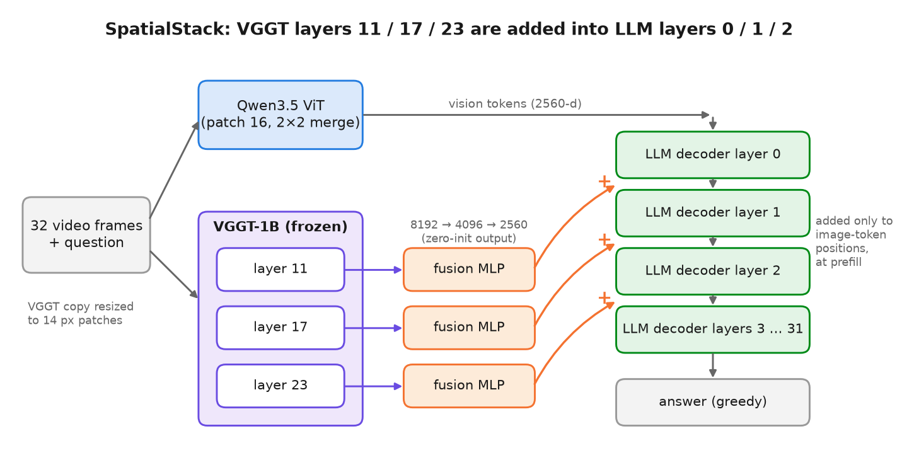
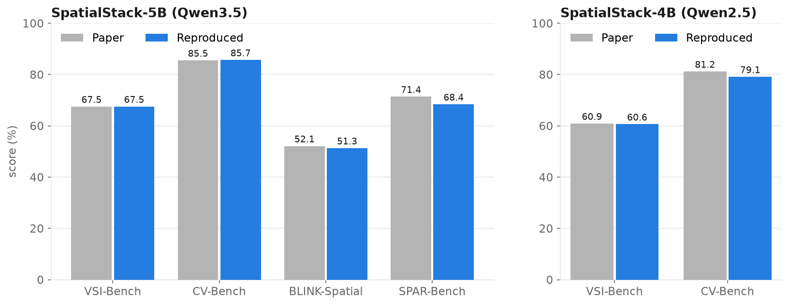
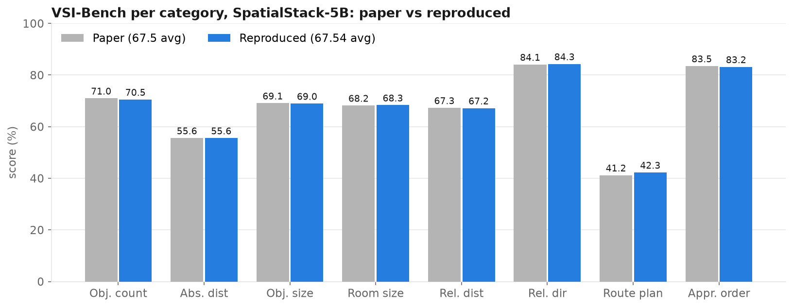
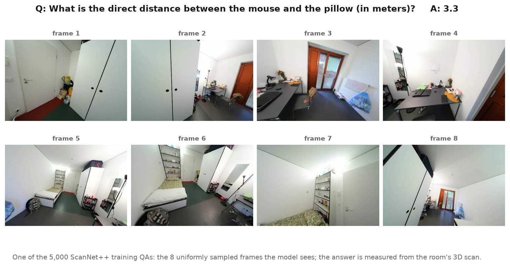
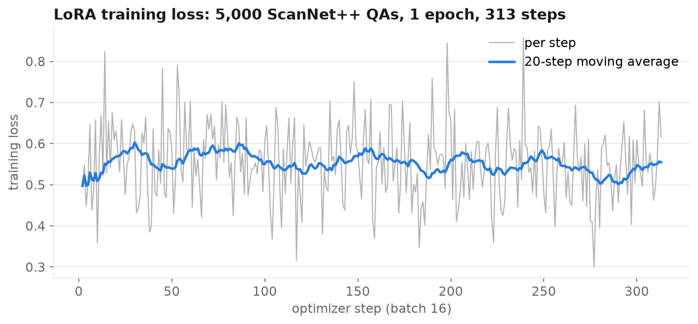
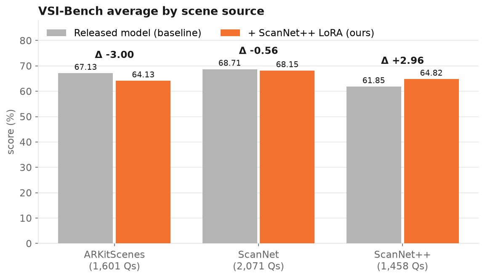
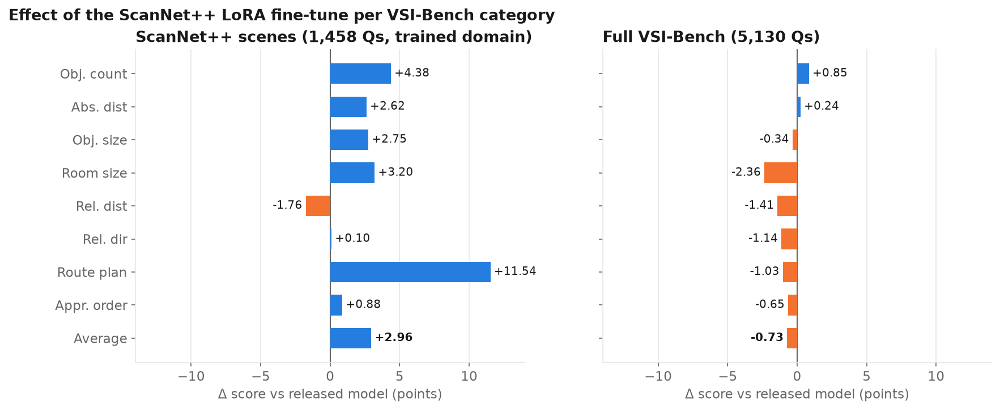

# SpatialStack: Reproduction and ScanNet++ LoRA Extension

We reproduce the evaluation results of the CVPR 2026 paper **SpatialStack: Layered Geometry-Language Fusion for 3D VLM Spatial Reasoning** (Zhang, Zhou, Liu, Kadambi, Fan). We then try to improve the released model with a small LoRA fine-tune on ScanNet++.

[Paper](https://huggingface.co/papers/2603.27437) · [Official code](https://github.com/jzh15/SpatialStack) · [Released model](https://huggingface.co/Journey9ni/SpatialStack-Qwen3.5-4B)

---

## TL;DR

| Question | Answer |
|---|---|
| Do the released checkpoints give the paper's numbers? | **Yes, on the main benchmark.** VSI-Bench: **67.54** vs paper 67.5 (5B), **60.62** vs 60.9 (4B). All 8 categories of the 5B model are within 1.1 points of the paper. |
| Anything that does not match? | SPAR-Bench is **3.0 points lower** (68.40 vs 71.39). Qwen2.5 CV-Bench 2D is 4.5 points lower. Everything else is within 1 point. |
| Does a ScanNet++ LoRA fine-tune help? | **On ScanNet++ scenes: +2.96** (61.85 → 64.82). **On the full VSI-Bench: −0.73** (67.54 → 66.81), mainly because ARKitScenes drops by 3.0. |
| Compute used | One shared RTX 6000 Ada (48 GB). Inference only for the reproduction; about 2.1 h of LoRA training. |

---

## Contents
1. [The paper in brief](#1-the-paper-in-brief)
2. [Reproduction](#2-reproduction)
3. [Extension: ScanNet++ LoRA fine-tune](#3-extension-scannet-lora-fine-tune)
4. [Repository layout](#4-repository-layout)
5. [How to run it yourself](#5-how-to-run-it-yourself)
6. [Acknowledgements and citation](#6-acknowledgements-and-citation)

---

## 1. The paper in brief

**Problem.** Vision-language models (VLMs) describe images well but are weak at **3D spatial reasoning**: distances, sizes, counts, relative directions and route planning in real rooms. One common fix adds a **3D geometry encoder**, such as VGGT, next to the vision encoder. These methods fuse the geometry **once**, usually at the input of the language model, so geometric detail from different depths of the encoder is collapsed into a single feature.

**Idea.** SpatialStack fuses geometry **at several depths ("stacking")**. It takes features from a shallow, a middle and a deep layer of the geometry encoder and injects each one into a different early layer of the LLM. Shallow layers carry local detail and deep layers carry global scene layout; each gets its own entry point into the language model.

<p align="center"></p>

**Concretely (from the code and the released `config.json`):**

| Component | Setting |
|---|---|
| LLM | Qwen3.5-4B: 32 decoder layers, hidden size 2560, hybrid linear/full attention (3:1) |
| Vision encoder | Qwen3.5 ViT, patch 16 px, 2×2 token merge |
| Geometry encoder | **VGGT-1B**, frozen. All video frames are encoded jointly, so features are multi-view consistent. |
| Stacking | VGGT layers **11 / 17 / 23** → added after LLM layers **0 / 1 / 2** (`feature_fusion_method = deepstack_language_add`) |
| Fusion module | One MLP per injection point: RMSNorm → 2×2 patch concat (8192) → 4096 → 2560. About 132M parameters in total. The **last layer is zero-initialised**, so training starts from the unchanged LLM. |
| Where it is added | Only at **image-token positions**, only at prefill. Text tokens are never modified. |
| Token alignment | The VGGT copy of each frame is resized so that its 14 px patch grid equals the ViT's 16 px grid. The two token streams then line up one-to-one. |
| Training (paper) | ≈212k samples (SPAR, LLaVA-Hound, ScanNet VSI-style QA, VSI appearance order), 1 epoch, lr 1e-5, global batch 64, full LLM fine-tune, ViT and VGGT frozen, 32× A100-80GB |

The paper reports SpatialStack-5B (Qwen3.5 base plus about 1B for VGGT) as the best open model on **VSI-Bench (67.5)**, ahead of Gemini-2.5 Pro (51.5) and GPT-4o (34.0).

---

## 2. Reproduction

### 2.1 What we ran

We did **no retraining**. We evaluated the two released checkpoints with the authors' own version of `lmms-eval` from the official repo, using the paper's evaluation settings.

| | |
|---|---|
| **Models** | `Journey9ni/SpatialStack-Qwen3.5-4B` (paper: *SpatialStack-5B, Qwen3.5*; main model)<br>`SpatialStack-Qwen2.5-4B` (paper: *SpatialStack-4B, Qwen2.5-VL-3B base*; older variant) |
| **Geometry encoder** | `facebook/VGGT-1B` |
| **Settings** | up to 32 video frames (uniform), `max_length=12800`, greedy decoding, flash-attention 2, thinking mode off (Qwen3.5) |
| **Hardware** | 1× NVIDIA RTX 6000 Ada (48 GB), shared with other users |
| **Code** | official repo at commit `b84ebaa`. We changed setup and data loading only; scoring is untouched (see [`scripts_repro/repo_changes/`](scripts_repro/repo_changes/)). |

| Benchmark | Questions | What it tests |
|---|---:|---|
| **VSI-Bench** | 5,130 | video QA in real indoor scenes (ARKitScenes, ScanNet, ScanNet++): counting, distances, sizes, directions, route planning, appearance order |
| CV-Bench | 2,638 | 2D (counting, spatial relation) and 3D (depth order, distance) questions on single images |
| BLINK-Spatial | 400 | multi-view reasoning, relative depth, spatial relation |
| SPAR-Bench | 7,211 | spatial perception and reasoning from multi-view images |
| MMSI-Bench | 1,000 | multi-image spatial intelligence (*extra: not reported in the paper*) |

### 2.2 Headline results

<p align="center"></p>

**SpatialStack-5B (Qwen3.5):**

| | VSI-Bench | CV-Bench (2D / 3D / Avg) | BLINK-Spatial | SPAR-Bench | Overall* | MMSI-Bench |
|---|---:|---:|---:|---:|---:|---:|
| Paper | 67.52 | 78.9 / 92.2 / 85.53 | 52.12 | 71.39 | 69.14 | not reported |
| **Reproduced** | **67.54** | **79.06 / 92.33 / 85.69** | **51.30** | **68.40** | **68.23** | **28.20** |
| Δ | +0.02 | +0.2 / +0.1 / +0.2 | −0.82 | **−2.99** | −0.91 | — |

\*Overall = mean of VSI, SPAR, BLINK-Spatial and CV, as in the paper's cross-benchmark table.

**SpatialStack-4B (Qwen2.5):**

| | VSI-Bench | CV-Bench (2D / 3D / Avg) | BLINK-Spatial | SPAR-Bench | MMSI-Bench |
|---|---:|---:|---:|---:|---:|
| Paper | 60.9 | 75.4 / 87.0 / 81.2 | not reported | not reported | not reported |
| **Reproduced** | **60.62** | **70.91 / 87.33 / 79.12** | 63.81 | 58.74 | 25.60 |
| Δ | −0.3 | −4.5 / +0.3 / −2.1 | — | — | — |

### 2.3 VSI-Bench, category by category

<p align="center"></p>

| Model | Avg | Obj. count | Abs. dist | Obj. size | Room size | Rel. dist | Rel. dir | Route plan | Appr. order |
|---|---:|---:|---:|---:|---:|---:|---:|---:|---:|
| Paper, 5B | 67.5 | 71.0 | 55.6 | 69.1 | 68.2 | 67.3 | 84.1 | 41.2 | 83.5 |
| **Reproduced, 5B** | **67.54** | 70.53 | 55.59 | 68.95 | 68.33 | 67.18 | 84.30 | 42.27 | 83.17 |
| Paper, 4B | 60.9 | 69.2 | 45.4 | 63.0 | 63.2 | 57.9 | 68.4 | 40.2 | 79.6 |
| **Reproduced, 4B** | **60.62** | 68.97 | 46.77 | 63.06 | 62.40 | 55.63 | 71.72 | 37.63 | 78.80 |

For the 5B model, every category is within 1.1 points of the paper; the largest gap is route planning at +1.07. For the 4B model the average matches, and individual categories are within ±3.3 points.

**How VSI-Bench is scored** (`src/lmms_eval/tasks/vsibench/utils.py`):
- Multiple-choice categories use exact match on the first word of the answer.
- Numeric categories (count, distances, sizes) use **Mean Relative Accuracy**: an answer gets credit at every threshold θ ∈ [0.5, 0.95] where |pred − gt| / gt ≤ 1 − θ, so close answers get partial credit.
- Relative direction is the mean of its easy, medium and hard subsets.
- The final score is the mean of the 8 categories.

### 2.4 Observations

- **SPAR-Bench gap (−3.0).** This is the only notable miss for the main model. We used the authors' task config unchanged; the paper may have used a different SPAR-Bench split or scoring variant. We did not find the cause.
- **BLINK multi-view reasoning is below chance.** The task asks whether the camera moved left or right between two frames. With 2 options chance is 50%, but the 5B model scores **18.8%** (25/133). It is not guessing: it answers the **opposite direction 81%** of the time (108/133). On "right" questions it says "left" in 73 of 74 cases. The 4B model scores 55.6%, but only because it answers "right" to every question and 55.6% of the answers are "right". Neither model solves this task.

  | 5B model | said "left" | said "right" |
  |---|---:|---:|
  | truth: right (74) | **73** | 1 |
  | truth: left (59) | 24 | **35** |

- **4B CV-Bench 2D (−4.5)** comes almost entirely from the **counting** questions (ADE20K 44%, COCO 71%). The 3D part matches (+0.3). Answers are clean option letters, so these are real errors, not parsing failures.

### 2.5 Engineering notes (what it took to run)

- **Two environments.** The Qwen3.5 model needs `transformers 5.3` with the `flash-attn`, `causal-conv1d` and `flash-linear-attention` kernels; we built them from source for CUDA 12.9 / sm_89. The Qwen2.5 model needs `transformers 4.50` and `datasets 3.6`. We use an overlay venv (`env_qwen25`) put first on `PYTHONPATH`, with its own datasets cache, because `datasets` 3.x cannot read 5.x Arrow caches.
- **Hugging Face access.** Three public benchmark configs set `token: True`, which fails with an expired token. We set them to `False`. BLINK is loaded from a local `save_to_disk` export (`scripts_repro/export_blink.py`).
- **Shared GPU.** Runs are queued behind a free-memory check with automatic out-of-memory retry (`queue_vsibench.sh`, `queue_qwen25.sh`). VSI-Bench at 32 frames needs about 27 GB of GPU memory and takes 6–10 h on one GPU.
- **Scores are recomputed** from the per-sample logs by [`scripts_repro/compare.py`](scripts_repro/compare.py) using the paper's conventions; the summaries are in `results/*/summary.md`.

---

## 3. Extension: ScanNet++ LoRA fine-tune

### 3.1 Motivation

Breaking the reproduced VSI-Bench score down by **scene source** shows a clear weak spot: the model is about 6 points worse on **ScanNet++** rooms (61.85) than on ARKitScenes (67.13) or ScanNet (68.71). The official repo defines a ScanNet++ VSI-style training set (`VLM3R_SCANNETPP`), but the paper's training mix never used it. So we ask:

> Can a cheap LoRA fine-tune on ScanNet++ video QA close this gap without hurting the other scene sources?

### 3.2 Training data

| | |
|---|---|
| Source | ScanNet++ VSI-style QA (VLM-3R annotations): 114,247 questions |
| Our subset | **5,000 questions**, stratified by category, covering **all 856 training scenes** (at least one question per scene) |
| Test leakage | **0 overlap** with VSI-Bench test scenes (checked in `make_subset.py`) |
| Frames | 8 uniformly sampled frames per video |

| Abs. distance | Counting | Rel. direction (3 variants) | Rel. distance | Object size | Room size |
|---:|---:|---:|---:|---:|---:|
| 1,250 | 1,000 | 1,250 | 600 | 600 | 300 |

<p align="center"></p>

### 3.3 What is trained

We start from the **released SpatialStack-5B checkpoint**, not from raw Qwen3.5.

| Component | Paper | Ours |
|---|---|---|
| LLM (32 decoder layers) | full fine-tune, lr 1e-5 | **LoRA r=16, α=32** on attention and MLP projections of all 32 layers: **30.5M params**, lr 1e-4 |
| Geometry fusion MLPs | full, lr 1e-5 | **full**, lr 1e-5 (fp32 master weights): **132.2M params** |
| ViT, ViT merger, VGGT, embeddings, LM head | frozen | frozen |
| **Trainable total** | ≈4.9B | **162.6M (2.6%)** |
| Data | ≈212k samples | 5k ScanNet++ samples |
| Schedule | 1 epoch, batch 64 | 1 epoch, batch 16 (1 × grad-accum 16), **313 steps**, cosine, warmup 3% |
| Hardware / time | 32× A100-80GB | **1× RTX 6000 Ada**, about **2.1 h**, 19.6 GB peak memory |

The LoRA is injected from outside the repo (`scripts_repro/lora/train_lora.py` wraps the authors' `train_qwen.train()`), so the official training code is unchanged. After training, the adapter is **merged** into the base weights, giving a checkpoint in the released layout that the same eval pipeline can load.

<p align="center"></p>

The loss starts low (about 0.5) and stays roughly flat, with a slight drop at the end. This is expected: the released model is already trained on very similar VSI-style ScanNet questions, so there is little left to fit on the training objective.

### 3.4 Results

<p align="center"></p>

| Scene source | Questions | Released model | + ScanNet++ LoRA | Δ |
|---|---:|---:|---:|---:|
| ARKitScenes | 1,601 | 67.13 | 64.13 | **−3.00** |
| ScanNet | 2,071 | 68.71 | 68.15 | −0.56 |
| **ScanNet++** (trained domain) | 1,458 | 61.85 | 64.82 | **+2.96** |
| **Full VSI-Bench** | 5,130 | 67.54 | 66.81 | **−0.73** |

<p align="center"></p>

| VSI-Bench | Avg | Obj. count | Abs. dist | Obj. size | Room size | Rel. dist | Rel. dir | Route plan | Appr. order |
|---|---:|---:|---:|---:|---:|---:|---:|---:|---:|
| **ScanNet++ only**, released | 61.85 | 63.41 | 48.90 | 67.94 | 69.20 | 66.20 | 74.53 | 23.08 | 81.58 |
| **ScanNet++ only**, + LoRA | **64.82** | 67.78 | 51.52 | 70.69 | 72.40 | 64.44 | 74.63 | 34.62 | 82.46 |
| Δ | **+2.96** | +4.38 | +2.62 | +2.75 | +3.20 | −1.76 | +0.10 | +11.54 | +0.88 |
| **Full**, released | 67.54 | 70.53 | 55.59 | 68.95 | 68.33 | 67.18 | 84.30 | 42.27 | 83.17 |
| **Full**, + LoRA | 66.81 | 71.38 | 55.83 | 68.61 | 65.97 | 65.77 | 83.16 | 41.24 | 82.52 |
| Δ | **−0.73** | +0.85 | +0.24 | −0.34 | −2.36 | −1.41 | −1.14 | −1.03 | −0.65 |

### 3.5 Discussion

- **In-domain gains are real and broad.** On ScanNet++ scenes the numeric categories we trained on all improve: count +4.4, absolute distance +2.6, object size +2.8, room size +3.2. The route-planning jump (+11.5) should be read with care. ScanNet++ has only **26** route-planning questions, so +11.5 points is 3 more correct answers, and we did not train on route planning at all.
- **Specialisation costs generality.** The same fine-tune loses 3.0 points on ARKitScenes, which neither we nor the authors trained on. Room size (−2.4 overall) and relative distance (−1.4) suffer most. Fitting one scene distribution shifted the model's priors, for example on room scale, away from the others.
- **Net effect: slightly negative (−0.7)** on the full benchmark. A better recipe would likely **mix ScanNet++ with replay data** from the original training mix (SPAR, ScanNet, ARKit-style QA), use a smaller LoRA learning rate, or keep the fusion MLPs frozen. We leave these for future work.

---

## 4. Repository layout

```
.
├── README.md                    this file
├── docs/figures/                README figures (generated by scripts_repro/make_figures.py)
├── scripts_repro/
│   ├── download.sh              download models + benchmarks from Hugging Face
│   ├── build_ext.sh, build_ext2.sh   build flash-attn / causal-conv1d / fla for CUDA 12.9, sm_89
│   ├── export_blink.py          local BLINK export used by the task configs
│   ├── run_eval.sh              one entry point: run_eval.sh <spatialstack|qwen25|base> "<benchmarks>" [limit]
│   ├── queue_vsibench.sh, queue_qwen25.sh   GPU-aware queues with OOM retry
│   ├── compare.py               recompute scores from per-sample logs, compare with the paper
│   ├── make_figures.py          generate all README figures from results/
│   ├── repo_changes/            our edits to the official repo (patch + changed files)
│   ├── lora/                    ScanNet++ LoRA: subset, training, merge, eval, comparison
│   └── unused_training_smoke/   early full-training smoke test (not used for results)
├── results/
│   ├── spatialstack/            5B: per-sample logs + results.json per benchmark, summary.md
│   ├── qwen25/                  4B: same layout
│   ├── lora/                    LoRA model on VSI-Bench
│   └── *_limit*/                small smoke runs
└── logs/                        eval / build / queue logs
```

---

## 5. How to run it yourself

```bash
# 0. official code at the commit we used, plus our setup changes
git clone https://github.com/jzh15/SpatialStack repo && git -C repo checkout b84ebaa
git -C repo apply ../scripts_repro/repo_changes/repo_changes.patch    # or copy scripts_repro/repo_changes/files/
pip install -e repo     # inside a py3.12 env with torch 2.10 + CUDA 12.9; see build_ext*.sh for the kernels

# 1. models and benchmarks
bash scripts_repro/download.sh

# 2. evaluate (paper settings: 32 frames, max_length 12800, greedy, thinking off)
bash scripts_repro/run_eval.sh spatialstack "vsibench,cvbench,blink_spatial,sparbench,mmsibench"
bash scripts_repro/run_eval.sh qwen25       "vsibench,cvbench,blink_spatial,sparbench,mmsibench"

# 3. compare with the paper
python scripts_repro/compare.py results/spatialstack results/qwen25

# 4. LoRA extension (see scripts_repro/lora/README.md for details)
python scripts_repro/lora/make_subset.py
bash   scripts_repro/lora/train_lora.sh
bash   scripts_repro/lora/eval_lora.sh <merged checkpoint> vsibench

# 5. figures
python scripts_repro/make_figures.py
```

Paths inside the scripts point at our machine (models on `/mnt/4dgs/spatialstack/models`); adjust them to yours.

---

## 6. Acknowledgements and citation

All credit for SpatialStack goes to the original authors; this repository only re-runs their released models and code. VGGT is by Meta AI. The training example image is from [ScanNet++](https://kaldir.vc.in.tum.de/scannetpp/) and is subject to its terms of use. Benchmarks belong to their respective authors.

```bibtex
@inproceedings{zhang2026spatialstack,
  title     = {Spatialstack: Layered geometry-language fusion for 3d vlm spatial reasoning},
  author    = {Zhang, Jian and Zhou, Shijie and Liu, Bangya and Kadambi, Achuta and Fan, Zhiwen},
  booktitle = {Proceedings of the IEEE/CVF Conference on Computer Vision and Pattern Recognition},
  pages     = {38678--38688},
  year      = {2026}
}
```
